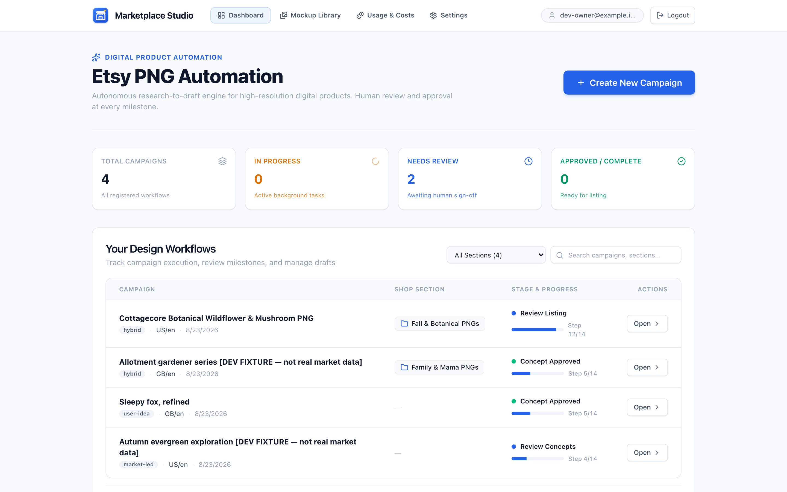
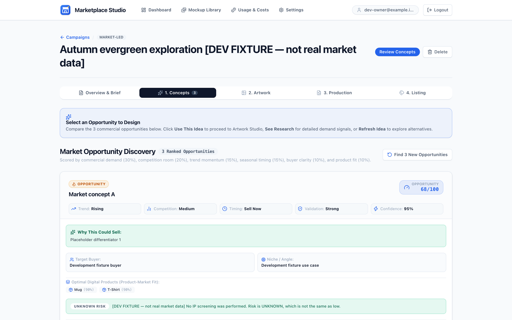
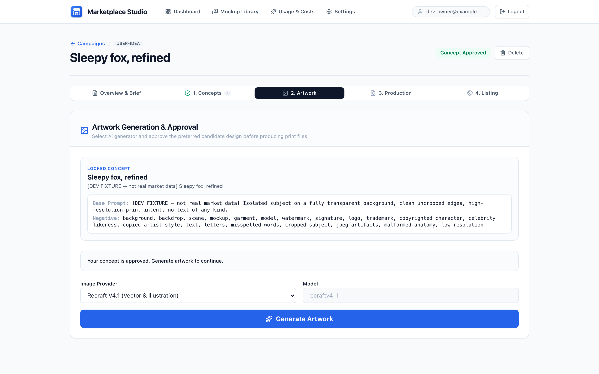
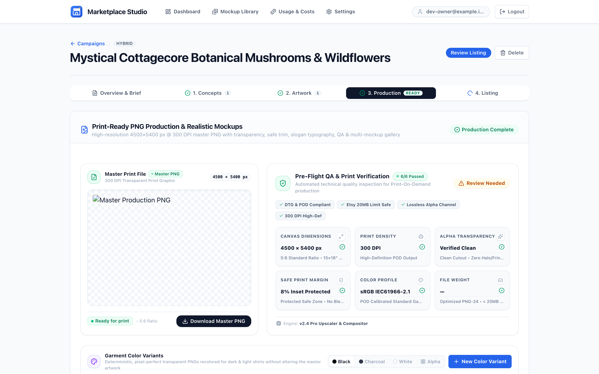
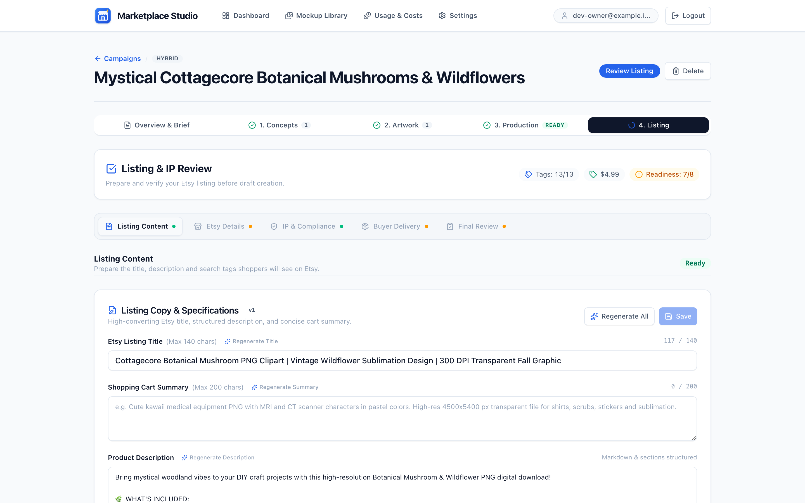
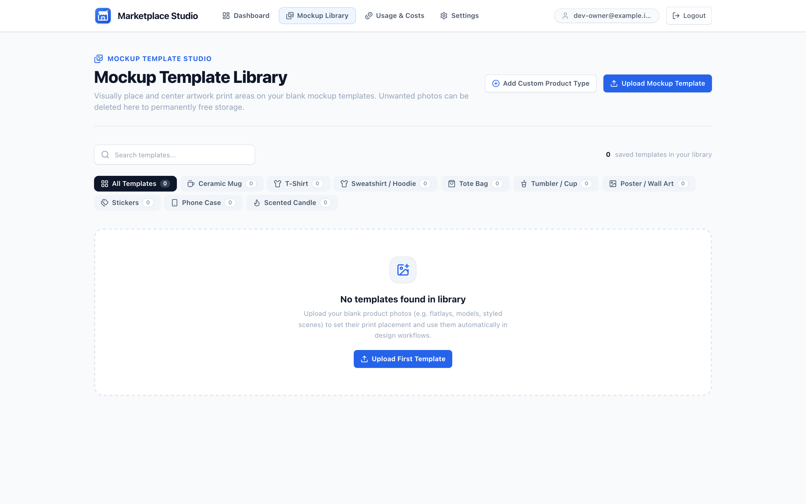
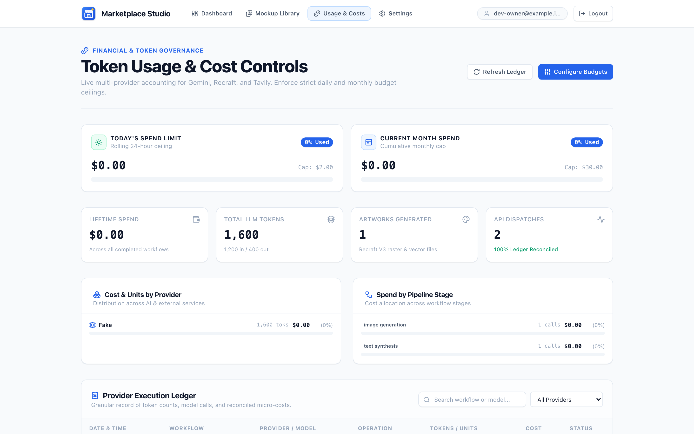
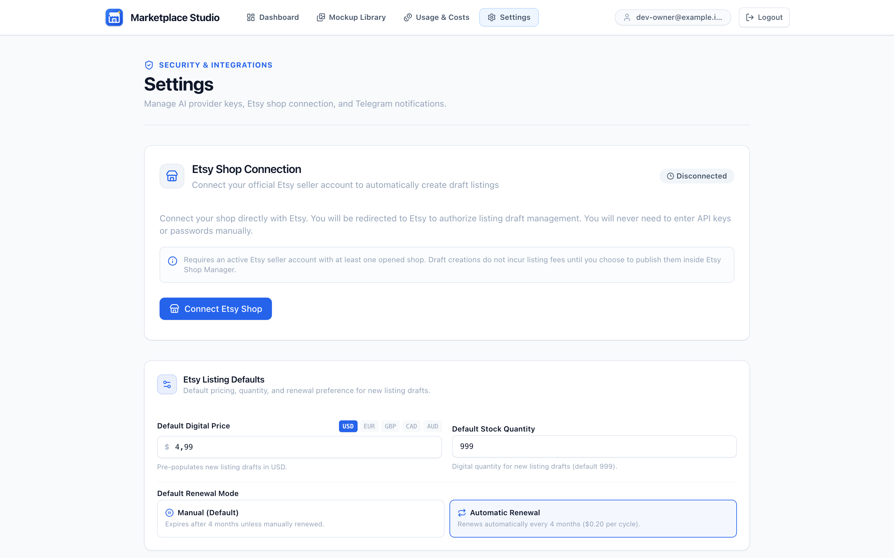

# Etsy PNG Automation

[](https://github.com/oussamac10/etsy-automation/actions)
[](LICENSE)
[](https://python.org)
[](https://nodejs.org)
[](https://nuxt.com)
[](https://fastapi.tiangolo.com)
[](https://postgresql.org)

An end-to-end, production-minded automation pipeline built for Etsy print-on-demand sellers: from market research, structured opportunity scoring, and AI artwork generation to print-ready 4500x5400 @ 300 DPI master PNG processing, custom product mockup compositing, and automated listing preparation.

> [!IMPORTANT]
> **Human-in-the-Loop Philosophy**: This system prepares work, but **never automatically publishes**. Every product must pass three mandatory human gates (Idea Approval, Artwork Approval, and Final Listing / IP Approval) before creating a draft on Etsy.

---

## 📸 Application Showcase

### 1. Studio Dashboard & Active Workflows

Manage all product workflows across their 16-stage lifecycle, track gate approvals, view compute expenditure, and launch new campaigns.



---

### 2. Gate 1: Market Intelligence & Concept Scoring

Evaluate market demand, competitive saturation, seasonal timing, buyer personas, and preliminary IP safety before generating artwork.



---

### 3. Gate 2: Multi-Model Artwork Studio & Variation Gallery

Generate and compare vector and raster designs with Recraft V4.1 and Gemini Flash, inspect prompts, and approve candidates for print production.



---

### 4. Phase 7: Print-Ready 4500×5400 Master PNG & Pre-Flight QA

Automated background removal, bounding-box trimming, 300 DPI upscaling, and a 10-point technical QA verification suite.



---

### 5. Gate 3: Listing Copy, 13 Tags & USPTO Trademark Clearance

AI-generated Etsy titles, structured descriptions with mandatory AI disclosure, 13 validated tags, live USPTO trademark screening, and customer ZIP packaging.



---

### 6. User Mockup Template Store

Upload and curate custom blank templates for T-shirts, mugs, tote bags, and sweatshirts with interactive 2D canvas positioning and blend modes.



---

### 7. Financial & Token Governance Ledger

Real-time tracking of AI provider token usage, image generation counts, compute duration, and estimated API expenditure per workflow.



---

### 8. Official Etsy Open API v3 Connection & Vault

Secure OAuth 2.0 PKCE shop authorization with AES-128-CBC + HMAC encrypted tokens, automatic token refresh, and safe draft creation.



---

## Key Features

### 1. Market Research & Idea Discovery (Phases 1-5)

- **3 Discovery Modes**:
  - *Discover Ideas*: Autonomous trend extraction across niches, buyer personas, and seasonality.
  - *Use My Idea*: Direct seller prompt & slogan input with automated keyword expansion.
  - *Hybrid*: Blends user-provided seed ideas with live market search signals.
- **Dual-Engine Market Intelligence**: Tavily web search + Gemini/OpenAI structured JSON extraction.
- **Algorithmic Opportunity Scoring**: Evaluates competition, buyer intent, seasonality, and risk.
- **Gate 1 Approval**: Interactive idea review with one-click approval, refinement, or rejection.

### 2. Multi-Model Artwork Generation (Phase 6)

- **State-of-the-Art AI Generators**: Native support for **Recraft V4.1** (Vector & Raster) and **Gemini 2.0 / 2.5 Flash Image**.
- **Interactive Multi-Variation Gallery**: Compare generated alternatives side-by-side with zoom and inspect tools.
- **Non-Destructive Refinement**: Iteratively refine approved artwork while retaining source asset lineage.
- **Gate 2 Approval**: Lock in master artwork before dispatching to production.

### 3. Print-Ready Production & 2D Mockup Compositor (Phase 7)

- **Master Print Engine**: Generates 4500x5400 @ 300 DPI sRGB transparent PNGs with automated margin trimming and upscaling.
- **Automated QA Validation**: 10-point automated quality inspection (pixel density, color space, alpha transparency, cropped edges, typography bounds).
- **User Mockup Template Store**: Upload and manage custom blank product templates (T-Shirts, Mugs, Sweatshirts, Posters, Stickers).
- **Interactive 2D Canvas Compositor**: Live client-side and server-side visual placement editor with real-time scaling, rotation, opacity, and blend modes (`multiply`, `screen`, `overlay`).
- **Dynamic Listing Cover Badges**: Set primary cover images and reorder mockups per product type with zero page reloads.

### 4. Preliminary IP Screening & Listing SEO Engine (Phase 8)

- **AI Listing Generator**: Generates high-intent Etsy Titles (< 140 chars), structured descriptions with mandatory AI disclosure, and exactly 13 search tags (≤ 20 chars per tag, no punctuation, 0 duplicates).
- **PostgreSQL USPTO Trademark Index**: High-performance `pg_trgm` GIN trigram index with streaming XML/CSV bulk dataset ingestion CLI (`scripts/ingest_uspto_trademarks.py`).
- **TSDR Candidate Verification**: Real-time live TSDR status and goods/services enrichment with encrypted `USPTO_API_KEY`.
- **Customer Download Package**: Deterministic customer ZIP generator containing 300 DPI master PNG, print-ready PDF, preview mockups, commercial licence (`LICENSE.txt`), buyer sizing instructions, and `manifest.sha256`.
- **Gate 3 Human Sign-Off**: Mandatory owner review of metadata, tag chips, and trademark risk acknowledgement before draft preparation.

### 5. Official Etsy Open API v3 Integration (Phase 9)

- **OAuth 2.0 PKCE Connection**: Secure 1-click seller shop connection with SHA-256 code challenge and Redis temporary state verification (`GET /api/v1/auth/etsy/connect`).
- **Encrypted Token Vault**: Fernet AES-128-CBC + HMAC encrypted tokens in PostgreSQL with proactive 5-minute pre-expiration auto-refresh.
- **Draft Listing Dispatcher**: Safe draft creation (`state: "draft"` strictly enforced), primary cover and preview mockup image uploads, and customer ZIP digital file delivery.
- **Absolute Non-Negotiable Safeguard**: Never automatically publishes or activates listings; zero active API calls; no auto-activation workers.

### 6. 2-Way Telegram Remote Control & Bot (Phase 4)

- Full remote control via Telegram bot: Receive instant notifications when gates require decisions.
- Approve or reject concepts and artwork directly from chat with interactive inline buttons.
- Direct links to newly created drafts in Etsy Shop Manager with zero publish buttons.

### 7. Robust Infrastructure & Cost Ledger

- **Deterministic State Machine**: 16-stage transition engine with optimistic locking and automated error triage.
- **Transactional Outbox Pattern**: Guarantees zero lost events between API and background workers.
- **Cost Accounting**: Tracks granular token usage, compute duration, and estimated API expenditure per workflow.
- **Automated Schema Sync**: Database models continuously synchronized with documentation in CI.

---

## System Architecture

```text
                                    ┌────────────────────────┐
                                    │    Nuxt 3 Dashboard    │
                                    │  (Vue 3, Pinia, Icons) │
                                    └───────────┬────────────┘
                                                │ REST / SSE
                                                ▼
┌───────────────────────┐           ┌────────────────────────┐           ┌────────────────────────┐
│  Telegram Bot Worker  │◄─────────►│     FastAPI Backend    │◄─────────►│   PostgreSQL 16 DB     │
│  (Remote Gate Control)│           │   (Domain, UoW, Ports) │           │ (State Machine, Outbox)│
└───────────────────────┘           └───────────┬────────────┘           └────────────────────────┘
                                                │
                                    ┌───────────┴────────────┐
                                    ▼                        ▼
                        ┌───────────────────────┐┌───────────────────────┐
                        │    General Worker     ││     Image Worker      │
                        │ (Dramatiq, S3 Storage)││(Fastify, Sharp Engine)│
                        └───────────────────────┘└───────────────────────┘
```

---

## State Machine & The Three Human Gates

```text
[DRAFT]
   │
   ▼
[RESEARCH_QUEUED] ──► [RESEARCHING] ──► [IDEA_REVIEW] (Gate 1: Idea Approval)
                                               │
                                               ▼
[ARTWORK_QUEUED] ──► [GENERATING_ARTWORK] ──► [UPSCALING_MASTER] ──► [ARTWORK_REVIEW] (Gate 2: Artwork Approval)
                                                                            │
                                                                            ▼
                                                [METADATA_GENERATION] ──► [LISTING_REVIEW] (Gate 3: Listing & IP Approval)
                                                                                │
                                                                                ▼
                                                                    [READY_FOR_ETSY_DRAFT]
                                                                                │
                                                                                ▼
                                                [CREATING_ETSY_DRAFT] ──► [UPLOADING_ASSETS] ──► [ETSY_DRAFT_CREATED]
```

---

## Quick Start (Docker Compose)

### Prerequisites

- **Docker** with Compose v2
- **Node.js** 24+ with `pnpm` 11+
- **Python** 3.12+ (for local scripts and tooling)

### 1. Launch the Stack

```bash
# Clone and configure environment (defaults to safe fake-provider mode)
cp .env.example .env

# Build and start all 8 services in background
docker compose up -d --build

# Wait for healthy services
docker compose up -d --wait api web worker image-worker
```

### 2. Service Access URLs

| Service | URL | Description |
| :--- | :--- | :--- |
| **Web Application** | [http://localhost:3000](http://localhost:3000) | Nuxt 3 seller workflow dashboard |
| **FastAPI REST API** | [http://localhost:8000/api/docs](http://localhost:8000/api/docs) | OpenAPI Swagger documentation |
| **API Health Check** | [http://localhost:8000/api/health](http://localhost:8000/api/health) | Live service & DB health probe |
| **Image Worker** | [http://localhost:8100/health](http://localhost:8100/health) | Sharp image processing worker |
| **MinIO Console** | [http://localhost:9001](http://localhost:9001) | S3 Object storage browser (`minioadmin` / `minioadmin`) |

---

## Local Development (Without Docker)

### 1. Install Dependencies

```bash
# TypeScript workspace packages
pnpm install

# Python virtual environment (API + Worker)
python3.12 -m venv .venv
./.venv/bin/pip install -e "backend[dev]" -e "workers/general-worker[dev]"
```

### 2. Start Core Infrastructure

```bash
docker compose up -d postgres redis minio minio-init
```

### 3. Run Development Services

```bash
# Terminal 1: Backend API
cd backend && ../.venv/bin/uvicorn app.main:create_app --factory --reload --port 8000

# Terminal 2: Dramatiq Worker
cd workers/general-worker && ../../.venv/bin/dramatiq worker.main

# Terminal 3: Sharp Image Worker
pnpm dev:image-worker

# Terminal 4: Nuxt 3 Frontend
pnpm dev:web
```

### 4. Database Migrations & Seeding

```bash
# Run latest Alembic migrations
cd backend && ../.venv/bin/alembic upgrade head

# Seed deterministic fixture workflows
cd backend && ../.venv/bin/python -m app.fixtures.dev_seed
```

---

## Development Commands & Quality Checks

```bash
# Monorepo Linting & Static Typing
pnpm lint                     # ESLint across all workspaces (0 warnings allowed)
pnpm typecheck                # TypeScript & vue-tsc checks
./.venv/bin/ruff check backend workers/general-worker
./.venv/bin/ruff format --check backend workers/general-worker
cd backend && ../.venv/bin/mypy .
cd workers/general-worker && ../../.venv/bin/mypy .

# Automated Tests
pnpm test                     # Vitest frontend & domain unit tests
cd backend && ../.venv/bin/pytest  # 500+ Backend unit & PostgreSQL integration tests
pnpm test:e2e                 # Playwright E2E suite against running stack

# Database Schema Documentation
pnpm doc:schema               # Regenerates docs/DATABASE_SCHEMA.md from models
pnpm doc:schema:check         # Verifies schema docs are in sync in CI
```

---

## Repository Layout

```text
├── backend/                  # FastAPI service (application, domain, ports, adapters, models)
│   ├── app/                  # REST routes, use cases, security, provider implementations
│   ├── migrations/           # Alembic database migration versions
│   └── scripts/              # Automated database schema generator tools
├── frontend/                 # Nuxt 3 web dashboard (Vue 3, Pinia, Tailwind CSS, Lucide icons)
│   ├── components/workflow/  # Workflow stage tabs, prompt modals, mockup canvas editor
│   ├── composables/          # Reactive API state, workflow controls, mockup manager
│   └── pages/                # App pages (Dashboard, Workflow detail, Library, Settings)
├── packages/
│   ├── domain/               # Shared TypeScript domain rules and Etsy tag validators
│   └── image-pipeline/       # Sharp-based image inspection, upscale, QA, and mockup compositor
├── workers/
│   ├── general-worker/       # Dramatiq background task worker (retries, outbox, telegram bot)
│   └── image-worker/         # Fastify service hosting high-performance Sharp operations
├── docs/                     # Comprehensive architecture, state machine, costs & schema docs
│   ├── DATABASE_SCHEMA.md    # Auto-generated PostgreSQL schema & Mermaid ERD
│   ├── architecture.md       # Layering, dependency inversion, and security
│   └── workflow.md           # Transition table and failure triage rules
└── compose.yaml              # Multi-container Docker Compose definition
```

---

## Documentation Index

| Document | Description |
| :--- | :--- |
| **[DATABASE_SCHEMA.md](docs/DATABASE_SCHEMA.md)** | Complete PostgreSQL table definitions, constraints, indexes, and Mermaid ERD. |
| **[architecture.md](docs/architecture.md)** | Hexagonal architecture, ports & adapters, transactional outbox, and security. |
| **[workflow-state-machine.md](docs/workflow-state-machine.md)** | Authoritative state transition matrix, error handling, and gate policies. |
| **[API_COSTS.md](docs/API_COSTS.md)** | AI provider pricing tables, token models, and budget safety constraints. |
| **[PHASES.md](docs/PHASES.md)** | Implementation milestones, phase deliverables, and acceptance criteria. |

---

## Notice & Disclaimer

This application is an independent software tool and is not endorsed by, sponsored by, or affiliated with Etsy, Inc. "Etsy" is a trademark of Etsy, Inc.
