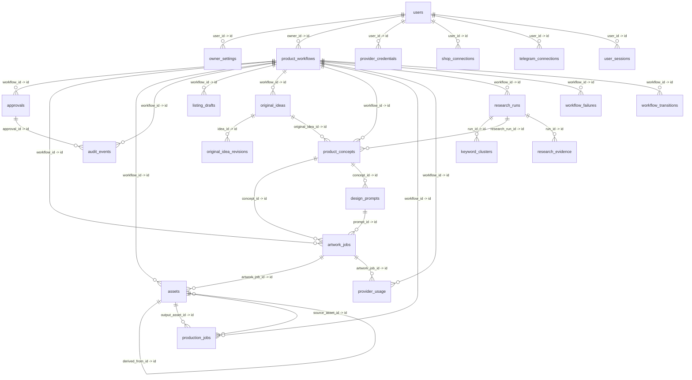

# PostgreSQL Database Schema Documentation

> [!NOTE]
> This document is automatically generated from SQLAlchemy model definitions in `backend/app/infrastructure/models/`. Run `python backend/scripts/generate_schema_docs.py` to update this document whenever models change.

## Overview & Entity-Relationship Diagram



---

## Database Tables by Domain

### Authentication & Settings

#### `users`

*System user accounts, credentials, and authentication records.*

| Column | Type | Nullable | Default | PK | FK / References |
| :--- | :--- | :--- | :--- | :--- | :--- |
| `id` | `CHAR(32)` | NO | `dynamic` | ✅ | - |
| `email` | `VARCHAR(320)` | NO | - | - | - |
| `display_name` | `VARCHAR(200)` | NO | - | - | - |
| `is_active` | `BOOLEAN` | NO | `True` | - | - |
| `password_hash` | `TEXT` | YES | - | - | - |
| `created_at` | `DATETIME` | NO | `dynamic` | - | - |
| `updated_at` | `DATETIME` | NO | `dynamic` | - | - |

- **Unique Constraints**: `email`

#### `user_sessions`

*Active web session tokens, CSRF protection hashes, and expiration timestamps.*

| Column | Type | Nullable | Default | PK | FK / References |
| :--- | :--- | :--- | :--- | :--- | :--- |
| `id` | `CHAR(32)` | NO | `dynamic` | ✅ | - |
| `user_id` | `CHAR(32)` | NO | - | - | `users.id` |
| `token_hash` | `VARCHAR(64)` | NO | - | - | - |
| `csrf_token` | `VARCHAR(64)` | NO | - | - | - |
| `expires_at` | `DATETIME` | NO | - | - | - |
| `revoked_at` | `DATETIME` | YES | - | - | - |
| `last_seen_at` | `DATETIME` | NO | `dynamic` | - | - |
| `user_agent` | `TEXT` | YES | - | - | - |
| `created_at` | `DATETIME` | NO | `dynamic` | - | - |

- **Unique Constraints**: `token_hash`
- **Check Constraints**: `ck_user_sessions_expiry_after_creation` (`expires_at > created_at`)
- **Indexes**: `ix_user_sessions_user_expires` on `user_id, expires_at`, `ix_user_sessions_user_id` on `user_id`

#### `owner_settings`

*Tenant/owner preferences, default marketplace options, and mockup presets.*

| Column | Type | Nullable | Default | PK | FK / References |
| :--- | :--- | :--- | :--- | :--- | :--- |
| `id` | `CHAR(32)` | NO | `dynamic` | ✅ | - |
| `user_id` | `CHAR(32)` | NO | - | - | `users.id` |
| `target_marketplace` | `VARCHAR(50)` | NO | `etsy` | - | - |
| `target_country` | `VARCHAR(2)` | NO | `US` | - | - |
| `currency` | `VARCHAR(3)` | NO | `USD` | - | - |
| `default_language` | `VARCHAR(10)` | NO | `en` | - | - |
| `default_idea_mode` | `VARCHAR(10)` | NO | `market-led` | - | - |
| `default_target_buyer` | `TEXT` | YES | - | - | - |
| `default_product_uses` | `ARRAY` | NO | `dynamic` | - | - |
| `style_preferences` | `ARRAY` | NO | `dynamic` | - | - |
| `style_notes` | `TEXT` | YES | - | - | - |
| `avoid_terms` | `ARRAY` | NO | `dynamic` | - | - |
| `default_quality_tier` | `VARCHAR(8)` | NO | `draft` | - | - |
| `min_output_pixels` | `INTEGER` | NO | `3000` | - | - |
| `require_transparent_background` | `BOOLEAN` | NO | `True` | - | - |
| `daily_budget_minor` | `BIGINT` | NO | `200` | - | - |
| `monthly_budget_minor` | `BIGINT` | NO | `3000` | - | - |
| `weekly_research_enabled` | `BOOLEAN` | NO | `False` | - | - |
| `weekly_research_weekday` | `INTEGER` | NO | `0` | - | - |
| `weekly_research_hour_utc` | `INTEGER` | NO | `9` | - | - |
| `notify_on_failure` | `BOOLEAN` | NO | `True` | - | - |
| `notify_on_budget_warning` | `BOOLEAN` | NO | `True` | - | - |
| `notify_on_approval_needed` | `BOOLEAN` | NO | `True` | - | - |
| `is_paused` | `BOOLEAN` | NO | `False` | - | - |
| `created_at` | `DATETIME` | NO | `dynamic` | - | - |
| `updated_at` | `DATETIME` | NO | `dynamic` | - | - |

- **Unique Constraints**: `user_id`
- **Check Constraints**: `ck_owner_settings_currency_alpha3` (`char_length(currency) = 3`), `ck_owner_settings_daily_budget_non_negative` (`daily_budget_minor >= 0`), `ck_owner_settings_daily_within_monthly` (`daily_budget_minor <= monthly_budget_minor`), `ck_owner_settings_monthly_budget_non_negative` (`monthly_budget_minor >= 0`), `ck_owner_settings_output_pixels_range` (`min_output_pixels BETWEEN 512 AND 20000`), `ck_owner_settings_style_preferences_bounded` (`cardinality(style_preferences) <= 20`), `ck_owner_settings_target_country_alpha2` (`char_length(target_country) = 2`), `ck_owner_settings_weekly_research_hour_range` (`weekly_research_hour_utc BETWEEN 0 AND 23`), `ck_owner_settings_weekly_research_weekday_range` (`weekly_research_weekday BETWEEN 0 AND 6`)

#### `provider_credentials`

*Encrypted third-party API keys (Recraft, Gemini, Tavily, OpenAI).*

| Column | Type | Nullable | Default | PK | FK / References |
| :--- | :--- | :--- | :--- | :--- | :--- |
| `id` | `CHAR(32)` | NO | `dynamic` | ✅ | - |
| `user_id` | `CHAR(32)` | NO | - | - | `users.id` |
| `provider` | `VARCHAR(8)` | NO | - | - | - |
| `ciphertext` | `BLOB` | NO | - | - | - |
| `key_version` | `INTEGER` | NO | - | - | - |
| `masked_value` | `VARCHAR(40)` | NO | - | - | - |
| `label` | `VARCHAR(120)` | YES | - | - | - |
| `created_at` | `DATETIME` | NO | `dynamic` | - | - |
| `updated_at` | `DATETIME` | NO | `dynamic` | - | - |

- **Unique Constraints**: `user_id, provider`
- **Check Constraints**: `ck_provider_credentials_ciphertext_not_empty` (`octet_length(ciphertext) > 0`), `ck_provider_credentials_key_version_positive` (`key_version >= 1`)
- **Indexes**: `ix_provider_credentials_user_id` on `user_id`

#### `telegram_connections`

*Paired Telegram accounts for 2-way approval gate workflows and notifications.*

| Column | Type | Nullable | Default | PK | FK / References |
| :--- | :--- | :--- | :--- | :--- | :--- |
| `id` | `CHAR(32)` | NO | `dynamic` | ✅ | - |
| `user_id` | `CHAR(32)` | NO | - | - | `users.id` |
| `telegram_user_id` | `BIGINT` | YES | - | - | - |
| `telegram_chat_id` | `BIGINT` | YES | - | - | - |
| `telegram_username` | `VARCHAR(120)` | YES | - | - | - |
| `pairing_code_hash` | `VARCHAR(64)` | YES | - | - | - |
| `pairing_code_expires_at` | `DATETIME` | YES | - | - | - |
| `failed_pairing_attempts` | `INTEGER` | NO | `0` | - | - |
| `paired_at` | `DATETIME` | YES | - | - | - |
| `revoked_at` | `DATETIME` | YES | - | - | - |
| `created_at` | `DATETIME` | NO | `dynamic` | - | - |
| `updated_at` | `DATETIME` | NO | `dynamic` | - | - |

- **Check Constraints**: `ck_telegram_connections_non_negative_failed_attempts` (`failed_pairing_attempts >= 0`)
- **Indexes**: `ix_telegram_connections_pairing_code_hash` on `pairing_code_hash`

#### `shop_connections`

*Etsy OAuth 2.0 shop connections, encrypted tokens at rest, scopes, and connection status.*

| Column | Type | Nullable | Default | PK | FK / References |
| :--- | :--- | :--- | :--- | :--- | :--- |
| `id` | `CHAR(32)` | NO | `dynamic` | ✅ | - |
| `user_id` | `CHAR(32)` | NO | - | - | `users.id` |
| `provider` | `VARCHAR(30)` | NO | `etsy` | - | - |
| `etsy_user_id` | `VARCHAR(60)` | NO | - | - | - |
| `etsy_shop_id` | `VARCHAR(60)` | NO | - | - | - |
| `etsy_shop_name` | `VARCHAR(120)` | NO | - | - | - |
| `ciphertext_access_token` | `BLOB` | NO | - | - | - |
| `ciphertext_refresh_token` | `BLOB` | NO | - | - | - |
| `key_version` | `INTEGER` | NO | - | - | - |
| `token_expires_at` | `DATETIME` | NO | - | - | - |
| `granted_scopes` | `ARRAY` | NO | `dynamic` | - | - |
| `connection_status` | `VARCHAR(40)` | NO | `connected` | - | - |
| `last_refreshed_at` | `DATETIME` | YES | - | - | - |
| `created_at` | `DATETIME` | NO | `dynamic` | - | - |
| `updated_at` | `DATETIME` | NO | `dynamic` | - | - |

- **Unique Constraints**: `user_id, provider`
- **Check Constraints**: `ck_shop_connections_access_token_not_empty` (`octet_length(ciphertext_access_token) > 0`), `ck_shop_connections_refresh_token_not_empty` (`octet_length(ciphertext_refresh_token) > 0`), `ck_shop_connections_shop_connection_key_version_positive` (`key_version >= 1`)
- **Indexes**: `ix_shop_connections_etsy_shop_id` on `etsy_shop_id`

### Workflow & State Machine Core

#### `product_workflows`

*Central aggregate managing the lifecycle of an automated product line.*

| Column | Type | Nullable | Default | PK | FK / References |
| :--- | :--- | :--- | :--- | :--- | :--- |
| `id` | `CHAR(32)` | NO | `dynamic` | ✅ | - |
| `owner_id` | `CHAR(32)` | NO | - | - | `users.id` |
| `idea_mode` | `VARCHAR(10)` | NO | - | - | - |
| `name` | `VARCHAR(200)` | NO | - | - | - |
| `target_marketplace` | `VARCHAR(50)` | NO | `etsy` | - | - |
| `target_country` | `VARCHAR(2)` | NO | - | - | - |
| `output_language` | `VARCHAR(10)` | NO | - | - | - |
| `target_buyer` | `TEXT` | YES | - | - | - |
| `intended_product_uses` | `ARRAY` | NO | `dynamic` | - | - |
| `state` | `VARCHAR(20)` | NO | `DRAFT` | - | - |
| `version` | `INTEGER` | NO | `1` | - | - |
| `archived_at` | `DATETIME` | YES | - | - | - |
| `created_at` | `DATETIME` | NO | `dynamic` | - | - |
| `updated_at` | `DATETIME` | NO | `dynamic` | - | - |

- **Indexes**: `ix_product_workflows_created_at` on `created_at`, `ix_product_workflows_owner_id` on `owner_id`, `ix_product_workflows_owner_state` on `owner_id, state`

#### `workflow_transitions`

*Immutable audit log of all state machine transitions with optimistic locking.*

| Column | Type | Nullable | Default | PK | FK / References |
| :--- | :--- | :--- | :--- | :--- | :--- |
| `id` | `CHAR(32)` | NO | `dynamic` | ✅ | - |
| `workflow_id` | `CHAR(32)` | NO | - | - | `product_workflows.id` |
| `from_state` | `VARCHAR(20)` | YES | - | - | - |
| `to_state` | `VARCHAR(20)` | NO | - | - | - |
| `reason` | `VARCHAR(200)` | NO | - | - | - |
| `actor` | `VARCHAR(200)` | NO | `system` | - | - |
| `resulting_version` | `INTEGER` | NO | - | - | - |
| `created_at` | `DATETIME` | NO | `dynamic` | - | - |

- **Indexes**: `ix_workflow_transitions_workflow_created` on `workflow_id, created_at`, `ix_workflow_transitions_workflow_id` on `workflow_id`

#### `workflow_failures`

*Structured error logs, triage categories, and exponential retry schedules.*

| Column | Type | Nullable | Default | PK | FK / References |
| :--- | :--- | :--- | :--- | :--- | :--- |
| `id` | `CHAR(32)` | NO | `dynamic` | ✅ | - |
| `workflow_id` | `CHAR(32)` | NO | - | - | `product_workflows.id` |
| `failure_state` | `VARCHAR(60)` | NO | - | - | - |
| `stage` | `VARCHAR(60)` | NO | - | - | - |
| `job_id` | `CHAR(32)` | YES | - | - | - |
| `error_kind` | `VARCHAR(60)` | NO | - | - | - |
| `error_message` | `TEXT` | NO | - | - | - |
| `attempt` | `INTEGER` | NO | `1` | - | - |
| `retryable` | `BOOLEAN` | NO | `False` | - | - |
| `next_retry_at` | `DATETIME` | YES | - | - | - |
| `resolved_at` | `DATETIME` | YES | - | - | - |
| `created_at` | `DATETIME` | NO | `dynamic` | - | - |

- **Check Constraints**: `ck_workflow_failures_failure_attempt_positive` (`attempt >= 1`)
- **Indexes**: `ix_workflow_failures_workflow_created` on `workflow_id, created_at`, `ix_workflow_failures_workflow_id` on `workflow_id`

#### `approvals`

*Gate decisions (Approved/Rejected/Refined) made via Web UI or Telegram.*

| Column | Type | Nullable | Default | PK | FK / References |
| :--- | :--- | :--- | :--- | :--- | :--- |
| `id` | `CHAR(32)` | NO | `dynamic` | ✅ | - |
| `workflow_id` | `CHAR(32)` | NO | - | - | `product_workflows.id` |
| `gate` | `VARCHAR(16)` | NO | - | - | - |
| `decision` | `VARCHAR(18)` | NO | `PENDING` | - | - |
| `actor` | `VARCHAR(200)` | NO | `owner` | - | - |
| `decided_at` | `DATETIME` | YES | - | - | - |
| `comment` | `TEXT` | YES | - | - | - |
| `revision_request` | `TEXT` | YES | - | - | - |
| `previous_state` | `VARCHAR(20)` | NO | - | - | - |
| `resulting_state` | `VARCHAR(20)` | NO | - | - | - |
| `target_type` | `VARCHAR(60)` | NO | - | - | - |
| `target_id` | `CHAR(32)` | YES | - | - | - |
| `target_version` | `INTEGER` | YES | - | - | - |
| `created_at` | `DATETIME` | NO | `dynamic` | - | - |

- **Check Constraints**: `ck_approvals_revision_requires_request_text` (`(decision <> 'REVISION_REQUESTED') OR (revision_request IS NOT NULL)`)
- **Indexes**: `ix_approvals_workflow_gate_created` on `workflow_id, gate, created_at`, `ix_approvals_workflow_id` on `workflow_id`

#### `audit_events`

*Comprehensive system audit event stream tracking mutations and decisions.*

| Column | Type | Nullable | Default | PK | FK / References |
| :--- | :--- | :--- | :--- | :--- | :--- |
| `id` | `CHAR(32)` | NO | `dynamic` | ✅ | - |
| `workflow_id` | `CHAR(32)` | YES | - | - | `product_workflows.id` |
| `approval_id` | `CHAR(32)` | YES | - | - | `approvals.id` |
| `action` | `VARCHAR(29)` | NO | - | - | - |
| `entity_type` | `VARCHAR(80)` | NO | - | - | - |
| `entity_id` | `CHAR(32)` | YES | - | - | - |
| `actor` | `VARCHAR(200)` | NO | `system` | - | - |
| `correlation_id` | `VARCHAR(80)` | YES | - | - | - |
| `before` | `JSONB` | YES | - | - | - |
| `after` | `JSONB` | YES | - | - | - |
| `event_metadata` | `JSONB` | NO | `dynamic` | - | - |
| `summary` | `TEXT` | NO | - | - | - |
| `created_at` | `DATETIME` | NO | `dynamic` | - | - |

- **Indexes**: `ix_audit_events_action_created` on `action, created_at`, `ix_audit_events_entity` on `entity_type, entity_id`, `ix_audit_events_workflow_created` on `workflow_id, created_at`, `ix_audit_events_workflow_id` on `workflow_id`

#### `outbox_messages`

*Transactional Outbox table for atomic event publishing to workers/external systems.*

| Column | Type | Nullable | Default | PK | FK / References |
| :--- | :--- | :--- | :--- | :--- | :--- |
| `id` | `CHAR(32)` | NO | `dynamic` | ✅ | - |
| `event_type` | `VARCHAR(100)` | NO | - | - | - |
| `payload` | `JSONB` | NO | `dynamic` | - | - |
| `processed` | `BOOLEAN` | NO | `False` | - | - |
| `created_at` | `DATETIME` | NO | `dynamic` | - | - |

- **Indexes**: `ix_outbox_messages_processed` on `processed`

### Phase 1 & Phase 2: Idea & Market Research

#### `original_ideas`

*Initial seed ideas or user prompt inputs initiating a workflow.*

| Column | Type | Nullable | Default | PK | FK / References |
| :--- | :--- | :--- | :--- | :--- | :--- |
| `id` | `CHAR(32)` | NO | `dynamic` | ✅ | - |
| `workflow_id` | `CHAR(32)` | NO | - | - | `product_workflows.id` |
| `original_text` | `TEXT` | NO | - | - | - |
| `normalized_text` | `TEXT` | NO | - | - | - |
| `slogan` | `VARCHAR(300)` | YES | - | - | - |
| `desired_style` | `VARCHAR(300)` | YES | - | - | - |
| `audience` | `VARCHAR(300)` | YES | - | - | - |
| `occasion` | `VARCHAR(200)` | YES | - | - | - |
| `season` | `VARCHAR(100)` | YES | - | - | - |
| `product_uses` | `ARRAY` | NO | `dynamic` | - | - |
| `revision_count` | `INTEGER` | NO | `0` | - | - |
| `created_at` | `DATETIME` | NO | `dynamic` | - | - |
| `updated_at` | `DATETIME` | NO | `dynamic` | - | - |

- **Unique Constraints**: `workflow_id`
- **Check Constraints**: `ck_original_ideas_original_text_not_trivial` (`length(original_text) >= 3`), `ck_original_ideas_revision_count_non_negative` (`revision_count >= 0`)

#### `original_idea_revisions`

*Versioned revisions of original ideas and prompt tweaks.*

| Column | Type | Nullable | Default | PK | FK / References |
| :--- | :--- | :--- | :--- | :--- | :--- |
| `id` | `CHAR(32)` | NO | `dynamic` | ✅ | - |
| `idea_id` | `CHAR(32)` | NO | - | - | `original_ideas.id` |
| `revision_number` | `INTEGER` | NO | - | - | - |
| `revised_text` | `TEXT` | NO | - | - | - |
| `normalized_text` | `TEXT` | NO | - | - | - |
| `slogan` | `VARCHAR(300)` | YES | - | - | - |
| `note` | `TEXT` | YES | - | - | - |
| `actor` | `VARCHAR(200)` | NO | `owner` | - | - |
| `created_at` | `DATETIME` | NO | `dynamic` | - | - |

- **Unique Constraints**: `idea_id, revision_number`
- **Check Constraints**: `ck_original_idea_revisions_revision_number_positive` (`revision_number >= 1`)
- **Indexes**: `ix_original_idea_revisions_idea_id` on `idea_id`

#### `research_runs`

*Market research execution tracking with evidence synthesis and queries.*

| Column | Type | Nullable | Default | PK | FK / References |
| :--- | :--- | :--- | :--- | :--- | :--- |
| `id` | `CHAR(32)` | NO | `dynamic` | ✅ | - |
| `workflow_id` | `CHAR(32)` | NO | - | - | `product_workflows.id` |
| `run_number` | `INTEGER` | NO | `1` | - | - |
| `status` | `VARCHAR(9)` | NO | `QUEUED` | - | - |
| `query_angles` | `ARRAY` | NO | `dynamic` | - | - |
| `confidence` | `VARCHAR(6)` | NO | `low` | - | - |
| `proposed_test` | `TEXT` | YES | - | - | - |
| `started_at` | `DATETIME` | YES | - | - | - |
| `completed_at` | `DATETIME` | YES | - | - | - |
| `failure_reason` | `TEXT` | YES | - | - | - |
| `idempotency_key` | `VARCHAR(200)` | YES | - | - | - |
| `created_at` | `DATETIME` | NO | `dynamic` | - | - |
| `updated_at` | `DATETIME` | NO | `dynamic` | - | - |

- **Unique Constraints**: `idempotency_key`
- **Check Constraints**: `ck_research_runs_run_number_positive` (`run_number >= 1`)
- **Indexes**: `ix_research_runs_workflow_id` on `workflow_id`

#### `research_evidence`

*Individual trend, buyer intent, and seasonality signals gathered from web search.*

| Column | Type | Nullable | Default | PK | FK / References |
| :--- | :--- | :--- | :--- | :--- | :--- |
| `id` | `CHAR(32)` | NO | `dynamic` | ✅ | - |
| `run_id` | `CHAR(32)` | NO | - | - | `research_runs.id` |
| `search_query` | `TEXT` | NO | - | - | - |
| `query_angle` | `VARCHAR(60)` | NO | - | - | - |
| `source_url` | `TEXT` | YES | - | - | - |
| `source_title` | `TEXT` | YES | - | - | - |
| `source_type` | `VARCHAR(11)` | NO | - | - | - |
| `observation` | `TEXT` | NO | - | - | - |
| `inference` | `TEXT` | YES | - | - | - |
| `observed_at` | `DATETIME` | NO | - | - | - |
| `market` | `VARCHAR(2)` | YES | - | - | - |
| `language` | `VARCHAR(10)` | YES | - | - | - |
| `seasonality_signal` | `VARCHAR(9)` | NO | `unknown` | - | - |
| `competition_signal` | `VARCHAR(14)` | NO | `unknown` | - | - |
| `buyer_intent_signal` | `VARCHAR(8)` | NO | `unknown` | - | - |
| `confidence` | `VARCHAR(6)` | NO | `low` | - | - |
| `created_at` | `DATETIME` | NO | `dynamic` | - | - |

- **Check Constraints**: `ck_research_evidence_observation_not_empty` (`length(observation) > 0`)
- **Indexes**: `ix_research_evidence_run_angle` on `run_id, query_angle`, `ix_research_evidence_run_id` on `run_id`

#### `keyword_clusters`

*Extracted SEO keyword groupings, search volume signals, and buyer intent tiers.*

| Column | Type | Nullable | Default | PK | FK / References |
| :--- | :--- | :--- | :--- | :--- | :--- |
| `id` | `CHAR(32)` | NO | `dynamic` | ✅ | - |
| `run_id` | `CHAR(32)` | NO | - | - | `research_runs.id` |
| `primary_phrase` | `VARCHAR(300)` | NO | - | - | - |
| `attributes` | `ARRAY` | NO | `dynamic` | - | - |
| `recipient_occasion_terms` | `ARRAY` | NO | `dynamic` | - | - |
| `use_case_terms` | `ARRAY` | NO | `dynamic` | - | - |
| `market` | `VARCHAR(2)` | NO | - | - | - |
| `language` | `VARCHAR(10)` | NO | - | - | - |
| `competition_level` | `VARCHAR(14)` | NO | `unknown` | - | - |
| `competition_note` | `TEXT` | YES | - | - | - |
| `relevance_rank` | `INTEGER` | NO | `0` | - | - |
| `created_at` | `DATETIME` | NO | `dynamic` | - | - |

- **Check Constraints**: `ck_keyword_clusters_relevance_rank_range` (`relevance_rank >= 0 AND relevance_rank <= 100`)
- **Indexes**: `ix_keyword_clusters_run_id` on `run_id`, `ix_keyword_clusters_run_rank` on `run_id, relevance_rank`

### Phase 3 & Phase 4: Concepts & Artwork

#### `product_concepts`

*Materially differentiated product design concepts scored across multiple metrics.*

| Column | Type | Nullable | Default | PK | FK / References |
| :--- | :--- | :--- | :--- | :--- | :--- |
| `id` | `CHAR(32)` | NO | `dynamic` | ✅ | - |
| `workflow_id` | `CHAR(32)` | NO | - | - | `product_workflows.id` |
| `original_idea_id` | `CHAR(32)` | YES | - | - | `original_ideas.id` |
| `research_run_id` | `CHAR(32)` | YES | - | - | `research_runs.id` |
| `title` | `VARCHAR(300)` | NO | - | - | - |
| `description` | `TEXT` | NO | - | - | - |
| `origin` | `VARCHAR(6)` | NO | - | - | - |
| `differentiation` | `TEXT` | NO | - | - | - |
| `target_buyer` | `TEXT` | YES | - | - | - |
| `buyer_use_case` | `TEXT` | YES | - | - | - |
| `bundle_potential` | `TEXT` | YES | - | - | - |
| `intended_product_uses` | `ARRAY` | NO | `dynamic` | - | - |
| `seasonality` | `VARCHAR(9)` | NO | `unknown` | - | - |
| `risk_level` | `VARCHAR(7)` | NO | `unknown` | - | - |
| `risk_note` | `TEXT` | YES | - | - | - |
| `score` | `NUMERIC(4, 2)` | YES | - | - | - |
| `score_breakdown` | `JSONB` | NO | `dynamic` | - | - |
| `score_explanation` | `TEXT` | YES | - | - | - |
| `status` | `VARCHAR(11)` | NO | `proposed` | - | - |
| `created_at` | `DATETIME` | NO | `dynamic` | - | - |
| `updated_at` | `DATETIME` | NO | `dynamic` | - | - |

- **Check Constraints**: `ck_product_concepts_differentiation_not_empty` (`length(differentiation) > 0`), `ck_product_concepts_score_range` (`score IS NULL OR (score >= 1.00 AND score <= 5.00)`)
- **Indexes**: `ix_product_concepts_original_idea_id` on `original_idea_id`, `ix_product_concepts_workflow_id` on `workflow_id`, `ix_product_concepts_workflow_score` on `workflow_id, score`, `ix_product_concepts_workflow_status` on `workflow_id, status`

#### `design_prompts`

*Engineered positive/negative prompts, typography directives, and style notes.*

| Column | Type | Nullable | Default | PK | FK / References |
| :--- | :--- | :--- | :--- | :--- | :--- |
| `id` | `CHAR(32)` | NO | `dynamic` | ✅ | - |
| `concept_id` | `CHAR(32)` | NO | - | - | `product_concepts.id` |
| `version` | `INTEGER` | NO | - | - | - |
| `positive_prompt` | `TEXT` | NO | - | - | - |
| `negative_prompt` | `TEXT` | NO | - | - | - |
| `typography_instructions` | `TEXT` | YES | - | - | - |
| `exact_slogan` | `VARCHAR(300)` | YES | - | - | - |
| `intended_product_uses` | `ARRAY` | NO | `dynamic` | - | - |
| `style_notes` | `TEXT` | YES | - | - | - |
| `palette` | `TEXT` | YES | - | - | - |
| `post_generation_checklist` | `ARRAY` | NO | `dynamic` | - | - |
| `generation_metadata` | `JSONB` | NO | `dynamic` | - | - |
| `change_note` | `TEXT` | YES | - | - | - |
| `created_at` | `DATETIME` | NO | `dynamic` | - | - |

- **Unique Constraints**: `concept_id, version`
- **Check Constraints**: `ck_design_prompts_negative_prompt_not_empty` (`length(negative_prompt) > 0`), `ck_design_prompts_prompt_version_positive` (`version >= 1`)
- **Indexes**: `ix_design_prompts_concept_id` on `concept_id`

#### `artwork_jobs`

*Image generation and refinement jobs executed across AI providers.*

| Column | Type | Nullable | Default | PK | FK / References |
| :--- | :--- | :--- | :--- | :--- | :--- |
| `id` | `CHAR(32)` | NO | `dynamic` | ✅ | - |
| `workflow_id` | `CHAR(32)` | NO | - | - | `product_workflows.id` |
| `concept_id` | `CHAR(32)` | NO | - | - | `product_concepts.id` |
| `prompt_id` | `CHAR(32)` | NO | - | - | `design_prompts.id` |
| `provider` | `VARCHAR(8)` | NO | - | - | - |
| `provider_model` | `VARCHAR(120)` | YES | - | - | - |
| `provider_job_id` | `VARCHAR(200)` | YES | - | - | - |
| `idempotency_key` | `VARCHAR(200)` | NO | - | - | - |
| `status` | `VARCHAR(9)` | NO | `QUEUED` | - | - |
| `attempt_count` | `INTEGER` | NO | `0` | - | - |
| `requested_width` | `INTEGER` | YES | - | - | - |
| `requested_height` | `INTEGER` | YES | - | - | - |
| `quality` | `VARCHAR(40)` | YES | - | - | - |
| `started_at` | `DATETIME` | YES | - | - | - |
| `completed_at` | `DATETIME` | YES | - | - | - |
| `failure_kind` | `VARCHAR(60)` | YES | - | - | - |
| `failure_message` | `TEXT` | YES | - | - | - |
| `created_at` | `DATETIME` | NO | `dynamic` | - | - |
| `updated_at` | `DATETIME` | NO | `dynamic` | - | - |

- **Unique Constraints**: `idempotency_key`
- **Check Constraints**: `ck_artwork_jobs_attempt_count_non_negative` (`attempt_count >= 0`)
- **Indexes**: `ix_artwork_jobs_workflow_id` on `workflow_id`, `ix_artwork_jobs_workflow_status` on `workflow_id, status`

#### `provider_usage`

*Granular token usage, compute duration, and API cost accounting per job.*

| Column | Type | Nullable | Default | PK | FK / References |
| :--- | :--- | :--- | :--- | :--- | :--- |
| `id` | `CHAR(32)` | NO | `dynamic` | ✅ | - |
| `workflow_id` | `CHAR(32)` | NO | - | - | `product_workflows.id` |
| `artwork_job_id` | `CHAR(32)` | YES | - | - | `artwork_jobs.id` |
| `provider` | `VARCHAR(8)` | NO | - | - | - |
| `service` | `VARCHAR(120)` | NO | - | - | - |
| `operation` | `VARCHAR(80)` | NO | - | - | - |
| `input_units` | `BIGINT` | NO | `0` | - | - |
| `output_units` | `BIGINT` | NO | `0` | - | - |
| `unit_kind` | `VARCHAR(40)` | NO | `units` | - | - |
| `currency` | `VARCHAR(3)` | NO | `USD` | - | - |
| `estimated_cost_minor` | `BIGINT` | NO | `0` | - | - |
| `actual_cost_minor` | `BIGINT` | YES | - | - | - |
| `status` | `VARCHAR(10)` | NO | `estimated` | - | - |
| `price_reference` | `JSONB` | NO | `dynamic` | - | - |
| `idempotency_key` | `VARCHAR(200)` | YES | - | - | - |
| `created_at` | `DATETIME` | NO | `dynamic` | - | - |
| `updated_at` | `DATETIME` | NO | `dynamic` | - | - |

- **Check Constraints**: `ck_provider_usage_actual_cost_non_negative` (`actual_cost_minor IS NULL OR actual_cost_minor >= 0`), `ck_provider_usage_estimated_cost_non_negative` (`estimated_cost_minor >= 0`), `ck_provider_usage_input_units_non_negative` (`input_units >= 0`), `ck_provider_usage_output_units_non_negative` (`output_units >= 0`), `ck_provider_usage_reconciled_requires_actual_cost` (`(status <> 'reconciled') OR (actual_cost_minor IS NOT NULL)`)
- **Indexes**: `ix_provider_usage_idempotency_key` on `idempotency_key`, `ix_provider_usage_provider_created` on `provider, created_at`, `ix_provider_usage_workflow_created` on `workflow_id, created_at`, `ix_provider_usage_workflow_id` on `workflow_id`

### Phase 7 & Phase 8: Production, Mockups, IP & Publishing

#### `assets`

*Canonical object storage registry for artwork, master print PNGs, and mockups.*

| Column | Type | Nullable | Default | PK | FK / References |
| :--- | :--- | :--- | :--- | :--- | :--- |
| `id` | `CHAR(32)` | NO | `dynamic` | ✅ | - |
| `workflow_id` | `CHAR(32)` | NO | - | - | `product_workflows.id` |
| `artwork_job_id` | `CHAR(32)` | YES | - | - | `artwork_jobs.id` |
| `derived_from_id` | `CHAR(32)` | YES | - | - | `assets.id` |
| `storage_key` | `VARCHAR(500)` | NO | - | - | - |
| `mime_type` | `VARCHAR(100)` | NO | - | - | - |
| `byte_size` | `BIGINT` | NO | - | - | - |
| `checksum_sha256` | `VARCHAR(64)` | NO | - | - | - |
| `width` | `INTEGER` | YES | - | - | - |
| `height` | `INTEGER` | YES | - | - | - |
| `has_alpha` | `BOOLEAN` | YES | - | - | - |
| `has_transparent_pixels` | `BOOLEAN` | YES | - | - | - |
| `quality_check` | `JSONB` | NO | `dynamic` | - | - |
| `provenance` | `JSONB` | NO | `dynamic` | - | - |
| `created_at` | `DATETIME` | NO | `dynamic` | - | - |
| `updated_at` | `DATETIME` | NO | `dynamic` | - | - |

- **Unique Constraints**: `workflow_id, checksum_sha256`
- **Check Constraints**: `ck_assets_asset_byte_size_positive` (`byte_size > 0`), `ck_assets_checksum_is_sha256` (`length(checksum_sha256) = 64`)
- **Indexes**: `ix_assets_checksum` on `checksum_sha256`, `ix_assets_workflow_id` on `workflow_id`

#### `production_jobs`

*Print-ready 4500x5400 @ 300 DPI master PNG processing & QA check pipeline.*

| Column | Type | Nullable | Default | PK | FK / References |
| :--- | :--- | :--- | :--- | :--- | :--- |
| `id` | `CHAR(32)` | NO | `dynamic` | ✅ | - |
| `workflow_id` | `CHAR(32)` | NO | - | - | `product_workflows.id` |
| `source_asset_id` | `CHAR(32)` | YES | - | - | `assets.id` |
| `output_asset_id` | `CHAR(32)` | YES | - | - | `assets.id` |
| `operations` | `ARRAY` | NO | `dynamic` | - | - |
| `status` | `VARCHAR(9)` | NO | `QUEUED` | - | - |
| `idempotency_key` | `VARCHAR(200)` | NO | - | - | - |
| `attempt_count` | `INTEGER` | NO | `0` | - | - |
| `qa_report` | `JSONB` | NO | `dynamic` | - | - |
| `qa_passed` | `BOOLEAN` | YES | - | - | - |
| `started_at` | `DATETIME` | YES | - | - | - |
| `completed_at` | `DATETIME` | YES | - | - | - |
| `failure_kind` | `VARCHAR(60)` | YES | - | - | - |
| `failure_message` | `TEXT` | YES | - | - | - |
| `created_at` | `DATETIME` | NO | `dynamic` | - | - |
| `updated_at` | `DATETIME` | NO | `dynamic` | - | - |

- **Unique Constraints**: `idempotency_key`
- **Check Constraints**: `ck_production_jobs_production_attempt_non_negative` (`attempt_count >= 0`)
- **Indexes**: `ix_production_jobs_workflow_id` on `workflow_id`, `ix_production_jobs_workflow_status` on `workflow_id, status`

#### `listing_drafts`

*Finalized Etsy product listing copy, tags, pricing, and draft assets.*

| Column | Type | Nullable | Default | PK | FK / References |
| :--- | :--- | :--- | :--- | :--- | :--- |
| `id` | `CHAR(32)` | NO | `dynamic` | ✅ | - |
| `workflow_id` | `CHAR(32)` | NO | - | - | `product_workflows.id` |
| `title` | `VARCHAR(200)` | NO | - | - | - |
| `description` | `TEXT` | NO | - | - | - |
| `tags` | `ARRAY` | NO | `dynamic` | - | - |
| `price_minor_units` | `BIGINT` | YES | - | - | - |
| `currency` | `VARCHAR(3)` | NO | `USD` | - | - |
| `taxonomy_id` | `INTEGER` | YES | - | - | - |
| `taxonomy_path` | `VARCHAR(500)` | YES | - | - | - |
| `ai_disclosure` | `TEXT` | YES | - | - | - |
| `licence_text` | `TEXT` | YES | - | - | - |
| `customer_instructions` | `TEXT` | YES | - | - | - |
| `ip_reviewed_phrase` | `VARCHAR(300)` | YES | - | - | - |
| `ip_risk_level` | `VARCHAR(7)` | NO | `unknown` | - | - |
| `ip_findings` | `JSONB` | NO | `dynamic` | - | - |
| `ip_acknowledged_at` | `DATETIME` | YES | - | - | - |
| `ip_acknowledged_by` | `VARCHAR(200)` | YES | - | - | - |
| `etsy_shop_id` | `VARCHAR(60)` | YES | - | - | - |
| `etsy_listing_id` | `VARCHAR(60)` | YES | - | - | - |
| `etsy_listing_url` | `VARCHAR(500)` | YES | - | - | - |
| `etsy_state` | `VARCHAR(30)` | YES | `draft` | - | - |
| `etsy_image_ids` | `ARRAY` | NO | `dynamic` | - | - |
| `etsy_file_id` | `VARCHAR(60)` | YES | - | - | - |
| `etsy_file_ids` | `ARRAY` | NO | `dynamic` | - | - |
| `etsy_dispatch_status` | `VARCHAR(40)` | NO | `not_started` | - | - |
| `etsy_last_synced_at` | `DATETIME` | YES | - | - | - |
| `etsy_failure_reason` | `TEXT` | YES | - | - | - |
| `etsy_draft_created_at` | `DATETIME` | YES | - | - | - |
| `version` | `INTEGER` | NO | `1` | - | - |
| `created_at` | `DATETIME` | NO | `dynamic` | - | - |
| `updated_at` | `DATETIME` | NO | `dynamic` | - | - |

- **Unique Constraints**: `etsy_listing_id`, `workflow_id`
- **Check Constraints**: `ck_listing_drafts_listing_price_non_negative` (`price_minor_units IS NULL OR price_minor_units >= 0`), `ck_listing_drafts_listing_tag_limit` (`cardinality(tags) <= 13`), `ck_listing_drafts_listing_version_positive` (`version >= 1`)

#### `trademark_records`

*PostgreSQL USPTO Trademark Registry mirror with trigram fuzzy search and TSDR status.*

| Column | Type | Nullable | Default | PK | FK / References |
| :--- | :--- | :--- | :--- | :--- | :--- |
| `id` | `CHAR(32)` | NO | `dynamic` | ✅ | - |
| `mark_text` | `VARCHAR(512)` | NO | - | - | - |
| `normalized_mark_text` | `VARCHAR(512)` | NO | - | - | - |
| `serial_number` | `VARCHAR(64)` | YES | - | - | - |
| `registration_number` | `VARCHAR(64)` | YES | - | - | - |
| `status_code` | `VARCHAR(32)` | YES | - | - | - |
| `status_text` | `VARCHAR(64)` | NO | `REGISTERED` | - | - |
| `is_live` | `BOOLEAN` | NO | `True` | - | - |
| `classes` | `JSONB` | NO | `dynamic` | - | - |
| `goods_services` | `TEXT` | YES | - | - | - |
| `owner_name` | `VARCHAR(512)` | YES | - | - | - |
| `filing_date` | `VARCHAR(32)` | YES | - | - | - |
| `registration_date` | `VARCHAR(32)` | YES | - | - | - |
| `source_file` | `VARCHAR(512)` | YES | - | - | - |
| `source_updated_at` | `DATETIME` | YES | - | - | - |
| `imported_at` | `DATETIME` | NO | `now()` | - | - |
| `created_at` | `DATETIME` | NO | `dynamic` | - | - |
| `updated_at` | `DATETIME` | NO | `dynamic` | - | - |

- **Indexes**: `ix_trademark_records_is_live` on `is_live`, `ix_trademark_records_mark_text` on `mark_text`, `ix_trademark_records_norm_live` on `normalized_mark_text, is_live`, `ix_trademark_records_normalized_mark_text` on `normalized_mark_text`, `ix_trademark_records_registration_number` on `registration_number`, `ix_trademark_records_trgm` on `normalized_mark_text`

---

## Automated Verification & Updates

This document is verified continuously in CI via `backend/tests/test_schema_docs.py`.
To regenerate this document after creating or modifying SQLAlchemy models:

```bash
python backend/scripts/generate_schema_docs.py
```
