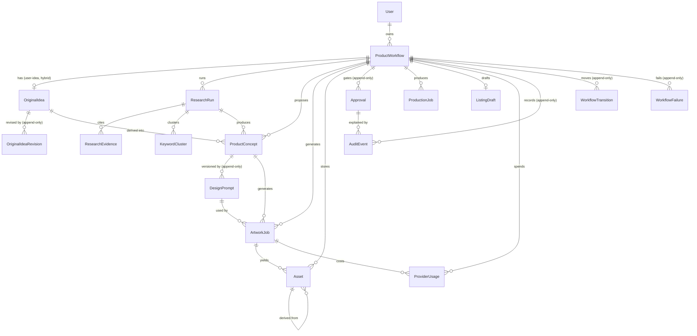

# Domain model

The entities, their relationships and the rules the schema enforces. The state
machine has its own document: [`workflow-state-machine.md`](workflow-state-machine.md).

Conventions used everywhere:

- **UUID primary keys**, generated in Python so an entity has an identity before
  it is flushed and a whole object graph can be built in one transaction.
- **Timezone-aware UTC timestamps** (`TIMESTAMP WITH TIME ZONE`).
- **PostgreSQL enum types** built from the domain enums, so an invalid value
  fails at the database rather than at read time. Adding a member needs a
  migration — deliberate, because these are the words the product is defined in.
- **Money as integer minor units** in `BIGINT` columns, never a float. See
  [`app/domain/money.py`](../backend/app/domain/money.py).
- **Append-only tables carry no `updated_at`.** The absence of the column is the
  point: there is no supported way to update an approval, an audit event or an
  idea revision, so the schema does not offer one.
- **No secrets.** No password hash, token, API key or connection string appears
  in any Phase 2 model. Phase 3 adds credential storage in its own tables.

---

## Entity relationships

---

## Naming: the spec's areas mapped to entities

The Phase 2 brief lists fifteen domain areas. Where a different name fits the
project better, this is the mapping.

| Required area | Entity | Why the name differs |
| --- | --- | --- |
| Users / account ownership | `User` | — |
| Projects / product workflows | `ProductWorkflow` | "Project" is ambiguous next to the repo itself; a workflow *is* the unit that moves through the state machine |
| Original user idea submissions | `OriginalIdea` + `OriginalIdeaRevision` | Split so the first submission is write-once and corrections are appended |
| Research runs | `ResearchRun` | — |
| Research evidence and sources | `ResearchEvidence` | — |
| Keyword clusters | `KeywordCluster` | — |
| Product concepts | `ProductConcept` | Phase 1's `ProductIdea` renamed: "idea" now means the owner's own words, and using it for both would blur exactly the distinction this phase exists to protect |
| Design prompts | `DesignPrompt` | Holds both the positive and negative prompt; they are one version |
| Artwork records and asset metadata | `ArtworkJob` + `Asset` | A job may produce several assets, and an asset may be derived from another |
| Approval gates and decisions | `Approval` | — |
| Production jobs | `ProductionJob` | — |
| Etsy listing draft metadata | `ListingDraft` | Also carries the preliminary IP review, because the acknowledgement gates the same decision |
| Provider usage and costs | `ProviderUsage` | — |
| Audit events | `AuditEvent` | — |
| Workflow errors and retries | `WorkflowFailure` | Plus `WorkflowTransition` for the state timeline |

Phase extensions added additional dedicated tables:

- **`TelegramConnection`** (`0004_phase_4_telegram.py`): Owner pairing codes and chat mappings for bot remote control.
- **`TrademarkRecord`** (`0010_trademark_records.py`): USPTO registered wordmarks, nice classes, and `pg_trgm` GIN index for local IP screening.
- **`ShopConnection`** (`0011_phase_9_etsy_connection.py`): Encrypted Etsy OAuth 2.0 PKCE access and refresh tokens.

---

## The entities

### `User`

Owner identity. `ProductWorkflow.owner_id` exists so ownership can be enforced
(Phase 3) and Phase 11 can add tenancy without backfilling every row.

| Column | Notes |
| --- | --- |
| `email` | unique |
| `display_name`, `is_active` | an inactive user cannot authenticate |
| `password_hash` | Argon2id, nullable; a row without one cannot sign in (Phase 3) |

### `UserSession`, `OwnerSettings`, `ProviderCredential` (Phase 3)

| Table | Notes |
| --- | --- |
| `user_sessions` | `token_hash` (unique, SHA-256 — the token itself is never stored), `csrf_token`, `expires_at` (`CHECK expires_at > created_at`), `revoked_at`, `last_seen_at`. `ON DELETE CASCADE` |
| `owner_settings` | one row per user (`user_id` unique), created on first read. Target market, idea/style preferences, quality floor, budgets in minor units, schedule and notification flags. Nine `CHECK` constraints, including `daily_budget_minor <= monthly_budget_minor` |
| `provider_credentials` | one row per `(user_id, provider)` (unique). `ciphertext` (Fernet, non-empty), `key_version` (`>= 1`), `masked_value`, `label`. **No column can hold plaintext** |

Credentials are the one place a row is deleted in normal operation: a removed
credential is not audit data, and the `CREDENTIAL_DELETED` audit event records
the removal. See [`authentication-and-secrets.md`](authentication-and-secrets.md).

### `ProductWorkflow`

The aggregate root. One product being taken from idea to Etsy draft.

| Column | Notes |
| --- | --- |
| `owner_id` | → `users`, `ON DELETE CASCADE` |
| `idea_mode` | `market-led` \| `user-idea` \| `hybrid`. Fixed at creation |
| `name`, `target_marketplace`, `target_country`, `output_language` | the brief |
| `target_buyer`, `intended_product_uses` | |
| `state` | the state machine's current position |
| `version` | optimistic lock; every state change bumps it |
| `archived_at` | nullable; archived workflows are hidden from lists by default |

Indexes: `(owner_id, state)`, `created_at`.

### `OriginalIdea` and `OriginalIdeaRevision`

**The centre of this phase.** `original_text` is written once and never updated.

| Column | Notes |
| --- | --- |
| `workflow_id` | unique — one idea per workflow |
| `original_text` | **immutable.** The owner's exact words |
| `normalized_text` | NFKC, collapsed whitespace, casefolded. Stored *beside* the original for comparison and search, never instead of it |
| `slogan` | kept apart from the descriptive text: it is rendered deterministically in Phase 7 and its spelling must survive untouched |
| `desired_style`, `audience`, `occasion`, `season`, `product_uses` | |
| `revision_count` | 0 means the original still stands |

A correction is an `OriginalIdeaRevision` row: `(idea_id, revision_number)` is
unique and numbered from 1. `OriginalIdea.current_text` reads the latest
revision, and `original_text` remains readable either way.

Three layers enforce this:

1. `SqlIdeaRepository` has no method that writes `original_text` after creation.
2. `guard_immutable()` inspects the attribute's SQLAlchemy history and raises
   `ImmutableFieldError` if someone assigned to it.
3. The use case refuses a second submission and points at the revision path.

### `ResearchRun`, `ResearchEvidence`, `KeywordCluster`

Storage only in Phase 2 — nothing calls a provider.

`ResearchRun` records the `query_angles` actually run (CLAUDE.md requires at
least three), a `confidence` level and, when confidence is low, a
`proposed_test`. `(workflow_id, run_number)` is unique, so a revision request
produces a *new* run rather than mutating the evidence behind the old concepts.

`ResearchEvidence` keeps `observation` (what the source states) and `inference`
(what we concluded) in **separate columns**. There is deliberately **no column
for a search volume, sales count or revenue figure**: inventing one is forbidden,
and there is nowhere honest to put it. Signals are qualitative enums —
`Seasonality`, `CompetitionLevel`, `SignalStrength`, `ConfidenceLevel` — each
backed by the observation text that justifies it.

`KeywordCluster` holds `primary_phrase`, `attributes`,
`recipient_occasion_terms`, `use_case_terms`, market, language, a
`competition_level` and the `competition_note` that explains what was observed.

### `ProductConcept` and `DesignPrompt`

| Column | Notes |
| --- | --- |
| `origin` | `user` \| `market` \| `hybrid` — recorded on **every** concept |
| `original_idea_id` | → `original_ideas`, `ON DELETE SET NULL`. Losing the link must not delete a concept the owner approved |
| `differentiation` | `NOT NULL` and non-empty: "the same but prettier" is not a differentiator, and an empty column would hide that |
| `score` | `NUMERIC(4,2)`, 1.00–5.00, nullable |
| `score_breakdown` | the seven weighted components, so a reviewer sees *why* |
| `status` | `proposed` \| `shortlisted` \| `approved` \| `rejected` \| `archived` |

**A low score never deletes or auto-rejects a concept.** Setting one aside is
`ARCHIVED`; only a human decision at the gate produces `REJECTED`.

`DesignPrompt` is versioned per concept — `(concept_id, version)` unique, from 1.
Editing creates version N+1; earlier versions are never modified, so an asset
stays traceable to the exact prompt that produced it. `negative_prompt` is
`NOT NULL` and non-empty. Typography is separate on purpose: when spelling
matters the image model is told to produce *no text*, and `exact_slogan` plus
`typography_instructions` drive the deterministic renderer instead.

### `ArtworkJob` and `Asset`

`ArtworkJob.idempotency_key` is **unique across the table**, so a duplicate
dispatch cannot create a second billable job. `prompt_id` uses `ON DELETE
RESTRICT`: an asset must stay traceable to its prompt version.

`Asset` records what was *measured*, not what was requested — `width`, `height`,
`has_alpha` and `has_transparent_pixels` are null until the file is inspected.
`(workflow_id, checksum_sha256)` is unique, and `derived_from_id` chains a
production output back to the untouched master.

### `Approval`

Append-only. One row per decision.

| Column | Notes |
| --- | --- |
| `gate`, `decision` | three gates; `PENDING` \| `APPROVED` \| `REJECTED` \| `REVISION_REQUESTED` |
| `actor`, `decided_at` | `decided_at` is null while `PENDING` — an unanswered request is not a decision |
| `comment`, `revision_request` | a `CHECK` requires `revision_request` when the decision is `REVISION_REQUESTED` |
| `previous_state`, `resulting_state` | readable without replaying the transition table |
| `target_type`, `target_id`, `target_version` | **an approval refers to a version, not just an entity** |

`is_approved()` reads the *most recent* decision at a gate, so a later rejection
or revision request actually revokes it.

### `ProductionJob` and `ListingDraft`

`ProductionJob` carries the ordered `operations`, a unique `idempotency_key`, and
a `qa_report` that flags problems without replacing artwork approval.

`ListingDraft` holds title, description, tags (a `CHECK` caps them at 13),
price in minor units, the AI disclosure, licence and instructions, plus the
preliminary IP review: `ip_risk_level` (never `safe`), `ip_findings`, and
`ip_acknowledged_at`/`ip_acknowledged_by` — gate 3 cannot be approved without the
acknowledgement. `etsy_listing_id` is unique so a resumed partial failure cannot
create a second listing.

**There is no `published_at` column and no publish flag.** The application
creates drafts; if the owner publishes, that is a workflow state change with
their name on it.

### `ProviderUsage`

| Column | Notes |
| --- | --- |
| `provider`, `service`, `operation` | |
| `input_units`, `output_units`, `unit_kind` | tokens, images, requests — named so a reader is not guessing |
| `currency`, `estimated_cost_minor`, `actual_cost_minor` | `BIGINT` minor units |
| `status` | `estimated` → `reconciled`, or `voided` |
| `price_reference` | the price entry used, with its `effective_from` and source URL |
| `idempotency_key` | ties the entry to the operation that caused it |

Both amounts stay on the row, so the gap between prediction and reality is
visible rather than lost. A `CHECK` refuses a `reconciled` row with no actual
amount. `effective_cost_minor` — the actual amount once reconciled, the estimate
until then, zero when voided — has a SQL mirror in the repository so the Python
property and the aggregate query cannot drift.

Aggregates: per operation, per workflow (per listing), per provider, per period
(monthly), and a budget comparison. All integer arithmetic end to end.

### `AuditEvent` and `WorkflowFailure`

`AuditEvent` is append-only and covers entity creation, idea revision, workflow
transition, approval decision, cost record, job status, failure, retry and
archive. `before`/`after`/`event_metadata` are structured JSONB and pass through
the **same redaction the logger uses** before being written, so an audit event
can never become the place a secret leaks.

`WorkflowFailure` is separate because a failure has a lifecycle a generic event
does not: `attempt`, `retryable`, `next_retry_at`, `resolved_at`. `error_message`
holds a message only — never a raw provider payload or a connection string.

`WorkflowTransition` records every state change with `from_state`, `to_state`,
`reason`, `actor` and `resulting_version`. The first row has a null `from_state`
and records the workflow's creation.

---

## Deletion behaviour

| Relationship | On delete | Why |
| --- | --- | --- |
| `product_workflows` → children | `CASCADE` | Deleting a workflow removes its whole story |
| `product_concepts.original_idea_id` | `SET NULL` | Losing the link must not delete an approved concept |
| `artwork_jobs.prompt_id` | `RESTRICT` | An asset must stay traceable to its prompt version |
| `production_jobs.source_asset_id` | `RESTRICT` | The approved master cannot vanish under a running job |
| `assets.derived_from_id` | `SET NULL` | A derived asset survives its parent |
| `audit_events.approval_id` | `SET NULL` | The event outlives the row it described |

Cascade from the workflow is the only bulk delete, and normal application flows
never trigger it: nothing in the API or the repositories deletes a workflow.

---

## What Phases 2 and 3 do *not* include

No Telegram, no research execution, no provider calls, no artwork generation, no
image processing, no Etsy OAuth or listing creation, and no deployment. In
particular there is still no `ShopConnection`: Etsy tokens arrive with the OAuth
flow in Phase 9, reusing the Phase 3 cipher. The tables for artwork, production
and listings exist and are empty by design — the phases that own them fill them
in.
