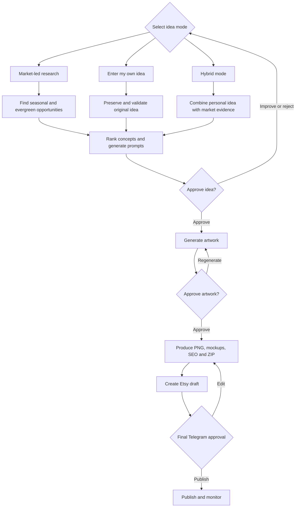

# Idea modes and approval flow

How a run starts (market-led, own idea, or hybrid) and how it moves through the
human approval gates.

## Idea modes

| Mode | Starting point | What research does |
| --- | --- | --- |
| **Market-led** | No idea yet | Runs the query angles, finds seasonal and evergreen opportunities, and proposes concepts from the evidence |
| **Enter my own idea** | You already have the concept | Preserves the original idea and validates it against evidence rather than replacing it |
| **Hybrid** | You have a direction | Combines your idea with market evidence — keyword clusters, competition signals and timing |

All three converge on the same step: ranked concepts, each with a complete
design prompt and a negative prompt.

## The three gates

The decision diamonds are the mandatory human gates from
[`workflow.md`](workflow.md). None can be skipped or automated:

1. **Approve idea?** — rejection loops back to mode selection; no artwork job is
   dispatched.
2. **Approve artwork?** — rejection regenerates; nothing enters production.
3. **Final approval** — the owner reviews the draft before anything goes live.

## Two notes on this diagram

**Telegram approval** is a delivery channel, not a new gate. The decision is the
same `LISTING_APPROVAL` gate; Telegram would just be where the owner receives it
and replies. It is not built — no notification channel exists yet, and adding one
means the approval must still be recorded against the immutable version that was
reviewed, exactly as an in-app approval is.

**"Publish and monitor"** sits outside what the application does. The workflow
ends at `ETSY_DRAFT_CREATED`; there is no publish method on `EtsyGateway` and no
published state in the state machine. In this diagram the `Publish` branch means
*the person publishes* after approving — the system prepares the draft and stops.
Etsy also charges a listing fee at publication, which is another reason that
action stays with a human.

## Implementation status

Not built. Phase 1 provides the state machine, the gates and the fake providers
only. Idea modes belong to Phase 4 (research and idea approval); artwork to
Phase 5; production, SEO and packaging to Phases 6–7; the Etsy draft to Phase 8.
