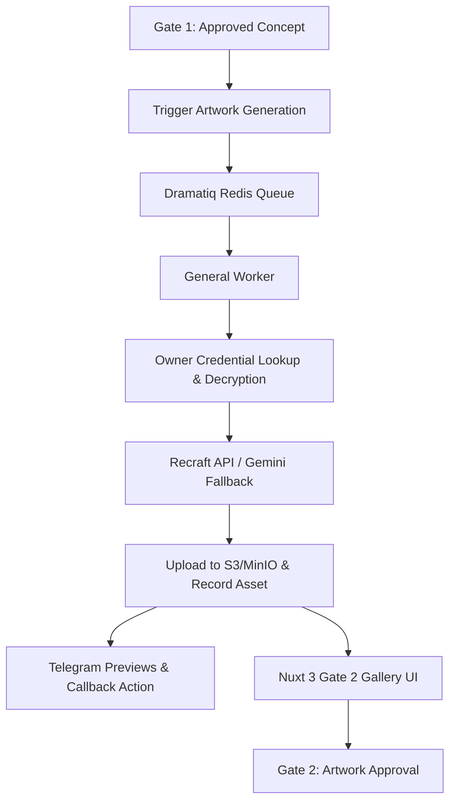

# Phase 6 — Artwork Generation and Gate 2 Approval

Completed: 2026-08-15  
Branch: `feature/phase-6-artwork-generation-approval`  

---

## 1. Objectives & Summary

Phase 6 implements live AI artwork generation, S3 object storage management, Gate 2 human approval, and credential configuration:

1. **AI Image Generation Providers**:
   - **Recraft V4.1**: Primary provider with automatic negative prompt omission for Recraft V4/V4.1 models.
   - **Gemini Flash / Pro**: Fallback provider for image generation and synthesis.
2. **Object Storage & Asset Management**:
   - S3 (MinIO locally) storage integration for asset uploads, SHA-256 checksums, and mime-type handling.
   - Separate internal Docker endpoint (`http://minio:9000`) and browser public endpoint (`http://localhost:9000`) with direct client-side signature generation.
3. **Gate 2 Artwork Approval Flow**:
   - Multi-candidate image generation and comparison gallery.
   - Human approval (`ARTWORK_APPROVED`), rejection (`ART_GENERATION_FAILED`), and image regeneration transitions.
   - Optimistic concurrency and idempotent job scheduling.
4. **Settings Page Credential Management**:
   - Integrated UI card for saving, revealing, and deleting encrypted API keys (`gemini`, `tavily`, `recraft`, `telegram`).
   - Reversible database migration `0008_phase_6_telegram.py` adding `telegram` to the `provider_name` enum.
   - Runtime fallback to decrypted database credentials if `.env` keys are omitted.

---

## 2. Architectural Highlights

---

## 3. Verification & Evidence

- **Pytest Suite**: All 248 backend unit and integration tests passing.
- **Database Migrations**: Migrations `0006_phase_6_gemini.py`, `0007_add_idempotency_key.py`, and `0008_phase_6_telegram.py` verified with complete upgrade/downgrade idempotency.
- **Frontend Tests**: 51 Vitest unit tests passing across all components.
